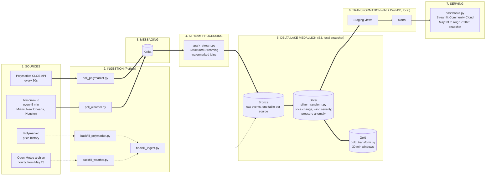
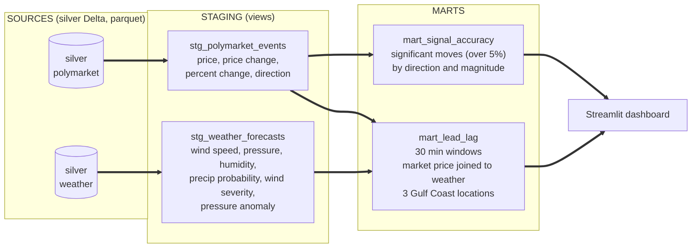

# Polymarket Weather Pipeline

Streaming pipeline analyzing whether Polymarket prediction markets lead or lag weather forecast updates on hurricane events. Dashboard serving a **May 23 to Aug 17 2026 snapshot** at [thoom-polymarket-weather.streamlit.app](https://thoom-polymarket-weather.streamlit.app), live AWS streaming paused.

***

## Analytical Question

Do informed traders on Polymarket price in hurricane developments before or after official forecast agencies publish updates?

***

## Architecture



Solid arrows are the live streaming path and dotted arrows are the historical backfill. Data was streamed to Delta Lake on S3 while AWS was live. The transformation layer and dashboard now run against a local snapshot of that data.

***

## Stack

- **Ingestion:** Python producers publishing to Apache Kafka
- **Stream Processing:** Spark Structured Streaming with watermarked joins
- **Storage:** Delta Lake medallion architecture (Bronze/Silver/Gold) on AWS S3
- **Transformation:** dbt with DuckDB adapter, reading S3 parquet while AWS was live and the local snapshot now
- **Dashboard:** Streamlit deployed on Streamlit Community Cloud
- **Data Sources:** Polymarket CLOB API, Tomorrow.io, Open-Meteo historical archive

***

## Data Sources

**Polymarket**: Live prediction market odds on Cat 5 hurricane US landfall via the CLOB API, polled every 30 seconds.

**Tomorrow.io**: Minutely weather forecasts for Miami, New Orleans, and Houston, polled every 5 minutes. Fields include wind speed, pressure, humidity, and precipitation probability.

**Open-Meteo**: Historical hourly weather archive used to backfill May 23 to present across all three locations.

***

## Pipeline Layers

**Bronze**: Raw events from Kafka written to Delta Lake on S3 as-is. One table per source.

**Silver**: Cleaned and enriched. Polymarket silver adds price change, percent change, and direction. Weather silver adds wind severity classification and pressure anomaly vs standard atmosphere (1013.25 hPa).

**Gold**: Aggregated to 30-minute windows. Significant price moves (>5% change) isolated. Market odds joined to weather conditions by time window across 3 Gulf Coast locations.

***

## dbt Models



- `stg_polymarket_events`: Staging view over silver parquet
- `stg_weather_forecasts`: Staging view over silver parquet
- `mart_lead_lag`: 30-minute windowed join of market prices to weather conditions
- `mart_signal_accuracy`: Distribution of significant price moves by direction and magnitude

***

## Setup

**Requirements:** Python 3.9+ (for local snapshot mode; full streaming requires Docker, Java 17+, AWS)

```bash
git clone https://github.com/praneel-thoom/polymarket-weather-pipeline.git
cd polymarket-weather-pipeline
pip install -r requirements.txt
docker compose up -d
export TOMORROW_API_KEY=your_key
export AWS_ACCESS_KEY=your_key
export AWS_SECRET_KEY=your_secret
export AWS_BUCKET=your_bucket
export AWS_REGION=us-east-2
python -u src/poll_polymarket.py >> logs/polymarket.log 2>&1 &
python -u src/poll_weather.py >> logs/weather.log 2>&1 &
export JAVA_HOME=$(/usr/libexec/java_home -v 21)
python src/spark_stream.py
```

**Run transforms:**

```bash
python src/silver_transform.py
python src/gold_transform.py
cd weather_markets && dbt run
```

***

## Project Structure

```
src/
├── poll_polymarket.py       Polymarket CLOB producer
├── poll_weather.py          Tomorrow.io weather producer
├── spark_stream.py          Spark Structured Streaming job
├── silver_transform.py      Silver layer transforms
├── gold_transform.py        Gold layer aggregations
├── backfill_polymarket.py   Historical Polymarket price backfill
├── backfill_weather.py      Historical weather backfill via Open-Meteo
├── backfill_ingest.py       Ingest backfill data into Delta Lake
└── dashboard.py             Streamlit dashboard

weather_markets/
└── models/
    ├── staging/             Staging views over silver Delta tables
    └── marts/               Lead-lag and signal accuracy marts

docker-compose.yml           Kafka, Zookeeper, MinIO
```

***

## Author

Praneel Thoom
[GitHub](https://github.com/praneel-thoom) · [pthoom6@gatech.edu](mailto:pthoom6@gatech.edu)
