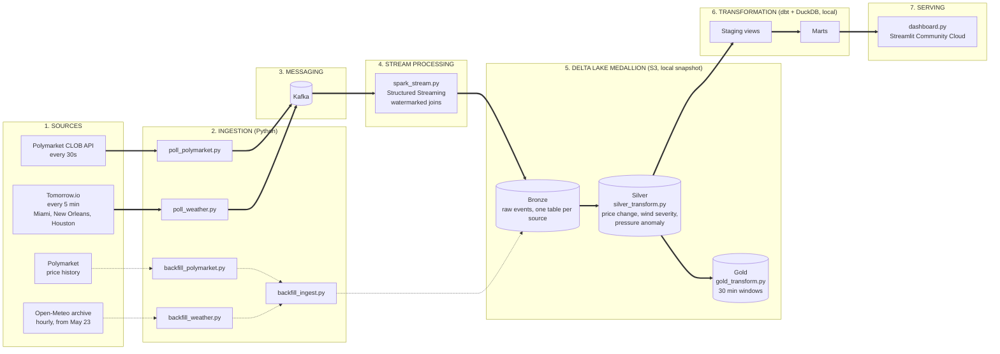
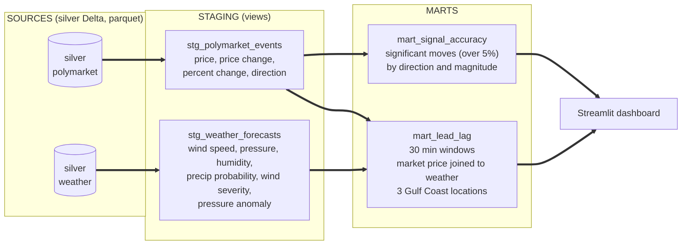

# Polymarket Weather Pipeline

> *Do prediction markets see the storm coming before the forecast does?*

A streaming data pipeline that tests whether Polymarket odds on hurricane landfall lead or lag weather forecast updates. Live data flows from the Polymarket and Tomorrow.io APIs through Kafka and Spark Structured Streaming into a Delta Lake medallion on S3, is modeled with dbt and DuckDB, and is served through a Streamlit dashboard.

**[View Live Dashboard](https://thoom-polymarket-weather.streamlit.app)** · Serving a **May 23 to Aug 17 2026 snapshot**. Live AWS streaming is paused.

***

## The Question

Do informed traders on Polymarket price in hurricane developments before or after weather forecasts update?

Prediction markets aggregate what traders believe about an event, while forecast models publish what the physics says. If traders react first, the market carries information the forecasts do not yet show. If they react after, the market is a lagging echo of public data. This project measures which one holds for Cat 5 hurricane US landfall odds across three Gulf Coast cities.

**How it is measured:** market odds and weather conditions are aligned into 30-minute windows, significant price moves (over 5% change) are isolated, and the timing of those moves is compared against forecast changes in Miami, New Orleans, and Houston.

<!-- TODO: add a Key Findings section here with 2 to 4 headline numbers from the dashboard -->

***

## Architecture



Solid arrows are the live streaming path and dotted arrows are the historical backfill. Data was streamed to Delta Lake on S3 while AWS was live. The transformation layer and dashboard now run against a local snapshot of that data.

***

## Data Sources

| Source | What it provides | Cadence |
| - | - | - |
| [Polymarket CLOB API](https://docs.polymarket.com) | Live odds on Cat 5 hurricane US landfall | Every 30 seconds |
| [Tomorrow.io](https://www.tomorrow.io) | Minutely weather forecasts for Miami, New Orleans, and Houston: wind speed, pressure, humidity, precipitation probability | Every 5 minutes |
| [Open-Meteo](https://open-meteo.com) | Historical hourly weather archive, used to backfill May 23 onward across all three locations | One-time backfill |
| Polymarket price history | Historical odds, used to backfill the period before live polling began | One-time backfill |

***

## Pipeline Layers

| Layer | Contents | Script |
| - | - | - |
| **Bronze** | Raw events from Kafka written to Delta Lake on S3 as-is, one table per source | `spark_stream.py` |
| **Silver** | Cleaned and enriched. Polymarket adds price change, percent change, and direction. Weather adds a wind severity class and pressure anomaly vs standard atmosphere (1013.25 hPa) | `silver_transform.py` |
| **Gold** | Aggregated to 30-minute windows. Significant price moves (over 5% change) isolated. Market odds joined to weather conditions by window across 3 Gulf Coast locations | `gold_transform.py` |

***

## dbt Models



| Model | Layer | Purpose |
| - | - | - |
| `stg_polymarket_events` | Staging view | Typed view over silver Polymarket parquet |
| `stg_weather_forecasts` | Staging view | Typed view over silver weather parquet |
| `mart_lead_lag` | Mart | 30-minute windowed join of market prices to weather conditions |
| `mart_signal_accuracy` | Mart | Distribution of significant price moves by direction and magnitude |

***

## Engineering Notes

- **Watermarked joins.** Spark Structured Streaming tolerates late-arriving events while keeping state bounded.
- **Checkpointed recovery.** Streaming checkpoints were stored on S3, so jobs resumed from their last committed offset after a restart.
- **Compaction.** A nightly OPTIMIZE and VACUUM kept the Delta tables from fragmenting into small files.
- **Always-on operation.** While AWS was live, the pollers and Spark jobs ran as supervised services with automatic restart.
- **Backfill path.** History before live polling began was loaded through separate backfill scripts that write into the same Bronze tables, so downstream layers treat live and historical data identically.

***

## Quick Start (Snapshot Mode)

Runs the dashboard from the local snapshot with no AWS, Kafka, or Spark required.

**Requirements:** Python 3.9+

```bash
git clone https://github.com/praneel-thoom/polymarket-weather-pipeline.git
cd polymarket-weather-pipeline
pip install -r requirements.txt
streamlit run src/dashboard.py
```

***

## Full Streaming Setup

**Requirements:** Python 3.9+, Docker, Java 17+, an AWS account, and a Tomorrow.io API key.

| Variable | Purpose |
| - | - |
| `TOMORROW_API_KEY` | Tomorrow.io weather API key |
| `AWS_ACCESS_KEY` | AWS access key for S3 |
| `AWS_SECRET_KEY` | AWS secret key for S3 |
| `AWS_BUCKET` | S3 bucket holding the Delta tables |
| `AWS_REGION` | Bucket region (`us-east-2`) |

```bash
git clone https://github.com/praneel-thoom/polymarket-weather-pipeline.git
cd polymarket-weather-pipeline
pip install -r requirements.txt
docker compose up -d

export TOMORROW_API_KEY=your_key
export AWS_ACCESS_KEY=your_key
export AWS_SECRET_KEY=your_secret
export AWS_BUCKET=your_bucket
export AWS_REGION=us-east-2

# Start the producers
python -u src/poll_polymarket.py >> logs/polymarket.log 2>&1 &
python -u src/poll_weather.py >> logs/weather.log 2>&1 &

# Start the Spark stream (macOS shown, point JAVA_HOME at your JDK)
export JAVA_HOME=$(/usr/libexec/java_home -v 21)
python src/spark_stream.py
```

**Run transforms:**

```bash
python src/silver_transform.py
python src/gold_transform.py
cd weather_markets && dbt run
```

***

## Known Limitations

- The dashboard serves a fixed snapshot (May 23 to Aug 17 2026). Live AWS streaming is paused, so new data is not arriving.
- Data from before live polling began comes from historical backfill endpoints, not the live pollers, so it was not captured at the same cadence.
- The analysis centers on one market (Cat 5 hurricane US landfall) and three Gulf Coast cities, so findings are exploratory and should not be generalized to other events or regions.
- Weather comes from a single commercial forecast provider (Tomorrow.io), not an official agency feed.

***

## Project Structure

```
src/
├── poll_polymarket.py       Polymarket CLOB producer
├── poll_weather.py          Tomorrow.io weather producer
├── spark_stream.py          Spark Structured Streaming job
├── silver_transform.py      Silver layer transforms
├── gold_transform.py        Gold layer aggregations
├── backfill_polymarket.py   Historical Polymarket price backfill
├── backfill_weather.py      Historical weather backfill via Open-Meteo
├── backfill_ingest.py       Ingest backfill data into Delta Lake
└── dashboard.py             Streamlit dashboard

weather_markets/
└── models/
    ├── staging/             Staging views over silver Delta tables
    └── marts/               Lead-lag and signal accuracy marts

docker-compose.yml           Kafka, Zookeeper, MinIO
```

***

## Tech Stack

| Layer | Technology |
| - | - |
| Ingestion | Python producers |
| Messaging | Apache Kafka (Docker Compose) |
| Stream processing | Spark Structured Streaming |
| Storage | Delta Lake medallion (Bronze, Silver, Gold) on AWS S3 |
| Transformation | dbt with DuckDB adapter |
| Dashboard | Streamlit Community Cloud |
| Data sources | Polymarket CLOB API, Tomorrow.io, Open-Meteo |

***

## Author

**Praneel Thoom**
[GitHub](https://github.com/praneel-thoom) · [pthoom6@gatech.edu](mailto:pthoom6@gatech.edu)
